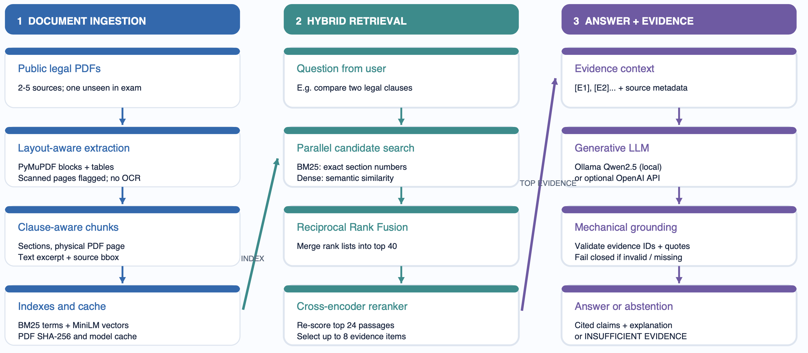

# LexiSyncAI - Evidence-Grounded Legal Document Analyst
Project Introduction

LexiSyncAI is an AI-powered legal document assistant developed as part of the DA3 Deep Learning & Generative AI final assignment.

The main goal of this project is to help users search, understand, and find relevant information from legal PDF documents more easily and efficiently.

Reading legal documents such as the General Data Protection Regulation (GDPR) and the EU AI Act can be time-consuming because they contain many pages, complex legal terms, and detailed regulations.

LexiSyncAI aims to simplify this process using Retrieval-Augmented Generation (RAG), a technique that combines information retrieval with Generative AI.

Instead of answering questions only from the AI model's existing knowledge, the system first searches the uploaded legal documents, finds the most relevant information, and then uses a language model to generate an answer based on that evidence.


## System Architecture



# Installation guide and steps to run the project :


### Step 1: Download and Open the Project
1. Unzip the project into your **Documents** folder.
2. Open **VS Code**.
3. Navigate to **File → Open Folder**.
4. Select the **LexiSyncAI** project folder.

### Step 2: Install Required Software
Make sure the following software is installed:

- **Python 3.12**
- **Ollama**
- **Visual Studio Code (VS Code)**

Install and start the Ollama application before proceeding.

### Step 3: Set Up the Python Environment
Open a new terminal in VS Code using **Terminal → New Terminal**.

Run the following command once:

```bash
bash setup_mac.sh
```

This command automatically:
- Creates a virtual environment (`.venv`) inside the project folder.
- Installs the required Python libraries.

Activate the virtual environment:

```bash
source .venv/bin/activate
```

Python will now use the project's virtual environment.

### Step 4: Download the Local Language Model
Make sure Ollama is running.

Execute:

```bash
ollama pull qwen2.5:3b
```

This downloads the **Qwen 2.5 (3B)** language model for local execution.

**Note:** The embedding model and reranker will download automatically during the first indexing operation. An internet connection is required for the initial setup.

### Step 5: Launch the LexiSyncAI Application
Run:

```bash
./run_mac.sh
```

The LexiSyncAI application should automatically open in your web browser using Streamlit.

**Note:** Streamlit does not require selecting a Jupyter kernel in VS Code.

### Step 6: Upload and Index Legal Documents
1. Open `docs/SOURCES.md`.
2. Download two real, publicly available legal PDF documents, for example:
   - General Data Protection Regulation (GDPR)
   - European Union Artificial Intelligence Act (EU AI Act)
3. Open the LexiSyncAI application.
4. Create a new case.
5. Upload both PDF documents.
6. Click **Index**.

Observe the extracted:
- Pages
- Text chunks
- Document sections
- Scanned-page flags

### Step 7: Test the RAG System
Perform the following tests:

**Test 1: Answer Verification**
- Ask a question with a verifiable answer.
- Select evidence **E1** to view the exact physical PDF page supporting the answer.

**Test 2: Multiple-Page Retrieval**
- Ask a question that requires information from two different physical PDF pages.
- Verify that the system retrieves relevant evidence from both pages.

**Test 3: Hallucination Prevention**
- Ask a question that cannot be answered using the uploaded documents.
- Confirm that the system does not invent unsupported information.

### Step 8: Understand the System Architecture
Open:

`docs/Architecture_One_Page.pdf`

Explain the architecture in the following sequence:

**Ingestion → Retrieval → Reranking → Generation → Verification → UI/Evaluation**

Review and practice the presentation script available at:

`docs/DEMO_SCRIPT.md`

Aim to complete the project demonstration within **5 minutes**.

### Step 9: Run the Evaluation
1. Create or locate the `evaluation/pdfs/` folder.
2. Copy the same two public legal PDF documents into this folder.
3. Run the retrieval-only evaluation:

```bash
python evaluate.py --retrieval-only
```

4. Run the evaluation with the language model:

```bash
python evaluate.py --with-llm
```

5. Check and revise the supporting phrases to match the PDF editions used.
6. Complete the manual review sheet.
7. Record actual evaluation results in:

`docs/RESULTS_TO_FILL.md`

8. Include the final evaluation metrics in the last slide of your presentation.

---

### Important Notes
- **Operating system:** These installation steps are intended for macOS.
- **Python version:** Python 3.12 is recommended for this project.
- **Local LLM:** Qwen 2.5 (3B), executed using Ollama.
- **User interface:** Streamlit.
- **Internet connection:** Required during initial installation and model downloads.
- **Offline execution:** After all required models and dependencies are downloaded, the project is designed to run locally without an internet connection.


## How the application works

| Component | Technique | Why it is used | Location |
|---|---|---|---|
| UI | Streamlit | case, PDF upload, index, questions, answer/citation pane | `app.py` |
| Ingestion | PyMuPDF position-aware blocks, two-column heuristic, repeating margin removal | retains page provenance and mitigates reading order artifacts | `lexisync/ingest.py` |
| Structure | regex article/clause recognition; paragraph-first splitting | keeps legal context and prevents spanning physical PDF pages | `lexisync/ingest.py` |
| Scan flags | low-text/high-image page detection | warns when input is likely image-only and not searchable | `lexisync/ingest.py` |
| Table parsing | PyMuPDF `find_tables()` | extracts simple tables as separate passages | `lexisync/ingest.py` |
| Lexical retrieval | BM25 Okapi (built here) | works well for exact numbers and section labels | `lexisync/retrieval.py` |
| Semantic retrieval | `all-MiniLM-L6-v2` sentence-transformer | matches similar wording even if terms differ | `lexisync/retrieval.py` |
| Fusion | reciprocal rank fusion (RRF) | combines BM25 and dense ranks robustly | `lexisync/retrieval.py` |
| Reranking | `ms-marco-MiniLM-L-6-v2` cross-encoder | rescoring on query/passage pairs | `lexisync/retrieval.py` |
| Generation | Ollama `qwen2.5:3b` local, or separate OpenAI API | writes concise evidence-bound natural-language claims | `lexisync/generation.py` |
| Verification | IDs + contiguous substring quotations | mechanically rejects fabricated citations; **not semantic entailment** | `lexisync/generation.py` |
| Citation UI | PDF page number, section, highlighted extracted bbox | user can inspect original text in context | `app.py` |
| Evaluation | 18 example questions, recall@k, latency, unanswerable cases; manual CSV | comparison and error analysis | `evaluate.py`, `evaluation/` |


## User-visible features

* Case name, public PDF uploader, 2–5 PDF validation; optional single-PDF oral-exam mode.
* Displays detected pages, chunks, sections, tables, and likely scanned page numbers.
* Four retrieval options: BM25, dense-only, hybrid, hybrid+reranker.
* Claim-by-claim evidence IDs and verifiable page/section citations, original page image and approximate block highlight.
* Refusal when the model reports insufficient evidence or cites invalid sources/quotes.
* Qualitative `HIGH`, `MEDIUM`, `LOW`, `INSUFFICIENT EVIDENCE`; **these are heuristics, not calibrated model confidence**.
* Measured retrieval/rerank/generation seconds and token counts when the provider supplies them.
* JSON output for manual audit.

# Project Scope and Limitations

## 1. Project Scope

The LexiSyncAI project is designed to help users search, understand, and retrieve information from legal PDF documents using Retrieval-Augmented Generation (RAG).

### Features Included in the Project

1. **Digital PDF Support**
   - The system supports digital PDF documents containing readable text.
   - Users can upload legal documents and search for relevant information.

2. **Legal Document Processing**
   - The system extracts text, sections, and pages from legal PDF documents.
   - It uses rule-based methods to identify document structure.

3. **Evidence-Based Answers**
   - The system generates answers using information retrieved from uploaded documents.
   - Users can view supporting evidence and check the original PDF pages.

4. **PDF Page References**
   - The system provides physical PDF page numbers starting from page 1.
   - These numbers help users locate the supporting information in the original document.

5. **Evidence Highlighting**
   - The system highlights extracted text regions on PDF pages.
   - This helps users identify where supporting information is located.

6. **Evidence Coverage Levels**
   - Answers are assigned `HIGH`, `MEDIUM`, or `LOW` evidence coverage levels.
   - These levels are calculated using predefined rules.

7. **Cross-Document Analysis**
   - The system can retrieve information from multiple uploaded documents.
   - The language model is instructed to consider differences or conflicts between documents.

8. **Error Handling**
   - If the language model connection fails, the application displays an error message.
   - It does not generate a misleading answer as a replacement.

### Features Outside the Project Scope

The following features are not implemented in the current version:

- OCR (Optical Character Recognition) for scanned documents.
- Training or fine-tuning a new language model.
- Fine-tuning an embedding model.
- Vision Language Models (VLMs) for image-based document understanding.
- Public deployment of the application.

---

## 2. Project Limitations

Although LexiSyncAI provides useful features for legal document analysis, it has some limitations.

1. **Legal Accuracy Is Not Guaranteed**
   - The system may generate an incorrect legal interpretation, even when it provides a correct quotation.
   - Important legal answers should be verified by a legal expert using the correct version of the law.

2. **Scanned PDFs Are Not Fully Supported**
   - The system works best with digital PDFs containing readable text.
   - OCR is not implemented, so scanned documents without a text layer cannot be reliably processed.
   - Some scanned pages may also be incorrectly identified.

3. **Complex Document Formatting**
   - The system uses rule-based methods to extract sections, tables, and text.
   - It may struggle with complicated tables, two-column layouts, and footnotes.
   - Extracted information may require manual verification.

4. **PDF Page Number Differences**
   - The system uses physical PDF page numbers.
   - These numbers may differ from the page numbers printed inside legal documents.
   - Users should check the original PDF when verifying citations.

5. **Highlighting Accuracy**
   - Highlighting identifies relevant extracted text blocks, not necessarily the exact words supporting a claim.
   - The accuracy of these highlighted regions has not been formally evaluated.

6. **Limited Conflict Detection**
   - The language model is instructed to consider conflicting information across documents.
   - However, the system does not have a fully tested conflict-detection mechanism.
   - It may miss conflicts or avoid answering when it notices uncertainty.

7. **Evidence Coverage Is Not Statistical Confidence**
   - `HIGH`, `MEDIUM`, and `LOW` indicate how well the retrieved evidence covers an answer according to predefined rules.
   - These levels do not represent the statistical probability that an answer is correct.

8. **Processing Time**
   - Large PDF documents, especially those exceeding 100 pages, may take longer to process.
   - Downloading the required AI models during initial setup may also take additional time.
   - Actual processing time depends on document size, hardware, and system performance.
  

## Partially Implemented Features

The following features have been partially implemented in LexiSyncAI. They are functional but require further improvements and evaluation.

### Feature 4: Bounding-Box Citations

**Current Implementation:**
- The system stores the coordinates of extracted text regions from PDF documents.
- It highlights the relevant text area on the original PDF page.
- This helps users locate and verify the evidence supporting an answer.

**Limitations:**
- The highlighted area may cover an entire text block instead of the exact quoted words.
- The accuracy of the highlighted regions has not been formally evaluated.


### Feature 9: Multi-Document Cross-Referencing

**Current Implementation:**
- The system can search and retrieve information from multiple uploaded PDF documents.
- It combines relevant information from different documents to generate answers.
- The language model is instructed to identify conflicting information between documents.

**Limitations:**
- Conflict detection depends on the language model's ability to recognize differences.
- A fully tested mechanism to detect and resolve conflicts between documents has not been implemented.


### Feature 11: Latency and Cost Report

**Current Implementation:**
- The system records the time taken for retrieval, reranking, and answer generation.
- It tracks input and output token usage when available.
- These measurements help users understand the system's performance.

**Limitations:**
- A complete cost analysis has not been performed.
- Performance improvements have not been formally measured and compared.


---

### Summary

| Feature | Current Functionality | Status |
|---------|----------------------|--------|
| Bounding-Box Citations | Highlights approximate evidence regions in PDF pages | Partially Implemented |
| Multi-Document Cross-Referencing | Retrieves information from multiple documents and can identify possible conflicts | Partially Implemented |
| Latency and Cost Report | Tracks processing time and available token usage | Partially Implemented |

**Note:** These features demonstrate the current capabilities of LexiSyncAI. Further development and testing are required to make them fully reliable.

### Important Note

LexiSyncAI is an academic project developed to demonstrate how RAG can support legal document analysis.

It is not a replacement for professional legal advice. Users should always verify important legal information using official sources and qualified experts.

